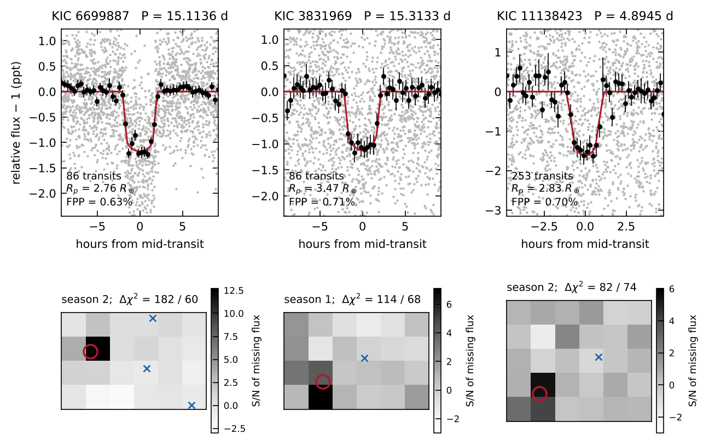

# ZyushgPlanet

A pre-registered transit search of 6,465 faint Kepler stars that were never Kepler targets. It found
**three sub-Neptune-sized transit candidates**: KIC 6699887, KIC 3831969 and KIC 11138423.

> **Status:** candidates, not validated planets. A Research Note is under consideration at RNAAS
> (manuscript AAS82486, submitted 2026-10-18). Data, code and evidence are archived at
> [doi:10.5281/zenodo.23442225](https://doi.org/10.5281/zenodo.23442225).



## Candidates

| | KIC 6699887 | KIC 3831969 | KIC 11138423 |
|---|---|---|---|
| Gaia DR3 | 2077554781499350144 | 2100154070473374976 | 2129669944725625344 |
| TIC | 270864056 | 120425498 | 424864042 |
| Host | G = 16.2, 4,542 K, 859 pc | G = 16.5, 5,275 K, 1,969 pc | G = 17.4, 4,258 K, 894 pc |
| Period (d) | 15.11366 +0.00006/−0.00005 | 15.31347 +0.00013/−0.00012 | 4.89443 ± 0.00002 |
| Depth (ppm) | 1,023 | 997 | 1,316 |
| Duration (h) | 3.8 | 4.0 | 1.9 |
| Radius (R⊕) | 2.76 +0.17/−0.14 | 3.47 +0.38/−0.32 | 2.83 +0.27/−0.24 |
| FPP (TRICERATOPS + MOLUSC) | 0.63 % | 0.71 % | 0.70 % |
| NFPP | 0 | 0 | 0 |

KIC 6699887 also shows a second on-target signal at 47.69 d (951 ppm, 28 transits).

Each candidate:

- localises on the target star in Kepler difference images, per quarter and per season;
- shows no odd–even or secondary-eclipse signal;
- matches the period and epoch of no KOI, DR25 TCE or Kepler eclipsing binary anywhere in the Kepler field, and no known object within 3′;
- has a transit-derived stellar density within 0.5σ of the Gaia DR3 FLAME value;
- was re-derived independently with separate code and survived an adversarial review.

Validation (FPP < 0.015 **and** NFPP < 0.001 in a refereed paper) still needs high-resolution imaging
of the hosts. The remaining risk is an unresolved companion within 0.5″.

Source of every number: `report/data.json` and `papers/rnaas/numbers.json`, built from `runs/` by
`scripts/report_data.py` and `papers/rnaas/build_note.py`.

## How the search worked

```
6,465 Kepler Bonus background dwarfs (frozen list, thresholds registered in advance)
  → 448 first-screen passes on real flux   (97 on inverted flux, 2 − f, same code)
  → 22 pass stage-2 vetting
  → 5 localise on the target in pixel tests
  → 4 survive independent re-derivation and red-team review
  → 3 candidates with FPP < 1 %            (the fourth, KIC 3963519, has FPP ≈ 39 %)
```

- **Pre-registration.** Parameters and thresholds are fixed in `pipeline/prereg_poolA.json`. Every
  later change is a dated `revision_log` entry and is labelled post hoc.
- **Null test.** Every star is also searched with its light curve flipped (2 − f). Real and inverted
  pass counts are always reported together.
- **Positive controls.** Known signals must be recovered, and known off-target signals rejected,
  before pool results are read (`runs/controls/`). The first failed control run is kept in
  `runs/controls_v1.0_failed/`.
- **Pixel localisation.** Point sources are fitted at the Gaia positions of the target and every
  neighbour within two pixels, per quarter and per Kepler season (`pipeline/pixel_vet.py`,
  `pipeline/pixel_season_stack.py`).
- **False-positive probability.** TRICERATOPS in Kepler mode, with companion limits from MOLUSC
  (Gaia RUWE and a Gaia contrast curve) and Gaia FLAME stellar parameters.

The light curves are Kepler Bonus PSF photometry: Martínez-Palomera, Hedges & Dotson 2023, AJ 166, 265;
MAST HLSP [doi:10.17909/7jbr-w430](https://doi.org/10.17909/7jbr-w430).

## Repository

| Path | Contents |
|---|---|
| `candidates/<kic>/` | Evidence pack per candidate (stage-2, pixels, deep run, FPP, transit fit, independent re-derivation, red team) with a SHA-256 manifest |
| `pipeline/` | Search and vetting package; see `pipeline/README.md` |
| `scripts/` | FPP inputs (MOLUSC, Gaia contrast curve), transit fits, field-wide ephemeris check, report export, evidence packs |
| `targets/` | The frozen target list (SHA-256 in the pre-registration) |
| `runs/` | Outputs behind every reported number; see `runs/README.md` |
| `papers/rnaas/` | The Research Note: template, build script, figure, compiled PDF |
| `report/` | Long-form report (`report/dist/report.html`, self-contained), five summary screens and a poster, built from `report/data.json` by `report/build.py` and `report/render.js` |
| `docs/` | Project notes: background, dataset, vetting, statistics, publishing, roadmap |

## Reproduce

Python 3.13; [uv](https://docs.astral.sh/uv/) recommended.

```sh
uv venv .venv && . .venv/bin/activate && uv pip install -r requirements.txt
python -m pipeline.fetch_known                                         # known-object catalogues, dated manifest
python -m pipeline.run_batch --config pipeline/prereg_poolA.json \
    --fnames kic-005689121 kic-007603200 --run-id controls --workers 2 # positive controls first
python -m pipeline.run_batch --config pipeline/prereg_poolA.json \
    --targets targets/poolA_kbonus_bg_dwarfs_ranked.csv --start 1 --stop 100 --run-id pilot --workers 3
python -m pipeline.triage --run-id pilot --config pipeline/prereg_poolA.json
python -m pipeline.vet_batch --run-id pilot --skip-done
python scripts/pixel_vet_survivors.py pilot pixel_v16
```

Downloaded data (`data/`) is not committed. Everything is re-fetched from MAST and the NASA Exoplanet
Archive. To run thousands of stars, `pipeline/modal_app.py` deploys the same code on
[Modal](https://modal.com), driven over HTTPS by `pipeline/modal_client.py`; the instructions are in
the module docstring.

## Language

In this repository nothing is called a planet. A star that passes the first screen has a
"first-screen signal"; after stage 2 it is a "signal". A signal becomes a "candidate" only after pixel
localisation, ephemeris clearance and a documented TRICERATOPS run. "Validated" means FPP < 0.015 and
NFPP < 0.001 in a refereed paper. The full rules are in `CLAUDE.md`.

## Background

The project began as a stricter replication of Kuber Mehta's October 2026 report of a transit
candidate on KIC 5689121, found with an AI coding agent in Kepler Bonus data
(`docs/01-anatomy-of-kic5689121.md`, `docs/03-kic5689121-reproduction-and-critique.md`).

## Citation and licence

Aayush Gupta ([ORCID 0009-0006-1165-0828](https://orcid.org/0009-0006-1165-0828)). Cite the
Zenodo record ([doi:10.5281/zenodo.23442225](https://doi.org/10.5281/zenodo.23442225)); see
`CITATION.cff`. Code is MIT-licensed; text, figures and results are CC BY 4.0 (`LICENSE`). Analysis
code was written with AI assistance (Claude); all results were reviewed by the author.
